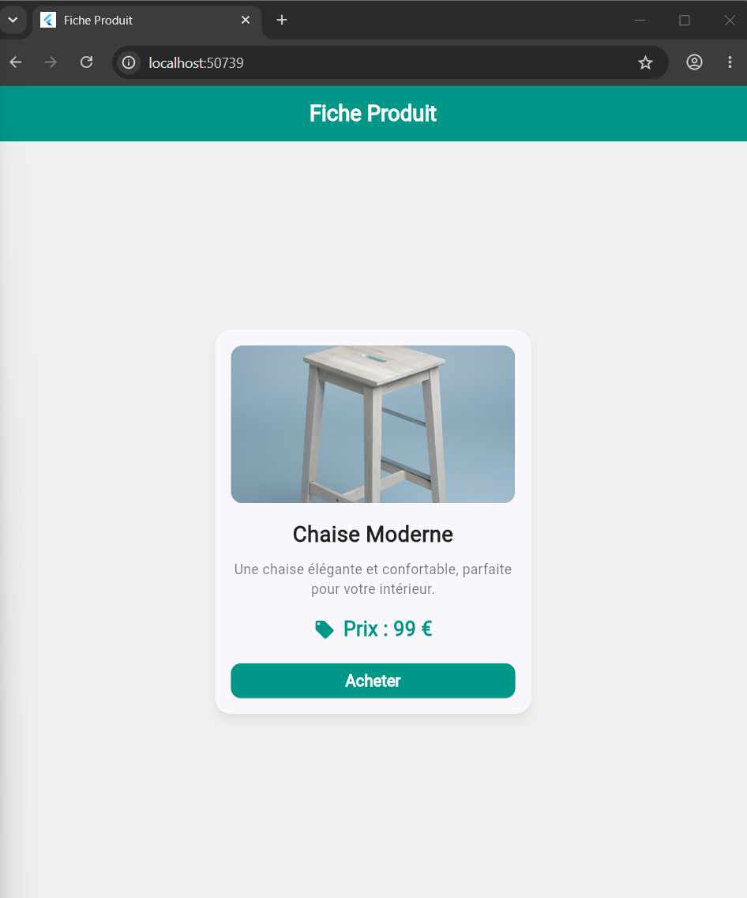
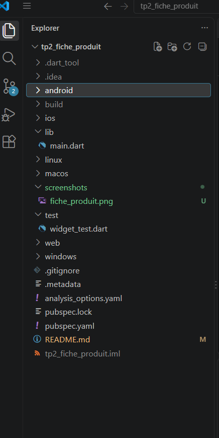

# 🛍️ TP2 — Fiche produit avec Flutter

> Développement d'une interface mobile présentant un produit à l'aide des widgets Flutter.

## 📌 Présentation

Ce projet a pour objectif de concevoir une fiche produit simple, structurée et agréable à consulter. Il permet de découvrir les widgets essentiels de Flutter et de comprendre comment les combiner pour construire une interface utilisateur.

## 🎯 Objectifs pédagogiques

- Découvrir la composition d'une interface avec Flutter.
- Organiser les éléments à l'aide de `Row` et `Column`.
- Maîtriser les espacements avec `Padding` et `SizedBox`.
- Personnaliser l'apparence d'une carte avec `Card` et `Container`.
- Ajouter un bouton d'action avec `ElevatedButton`.

## ✨ Fonctionnalités

- Présentation visuelle du produit.
- Affichage du nom et du prix.
- Bouton « Acheter ».
- Mise en page organisée et lisible.
- Personnalisation visuelle avec des marges, des coins arrondis et des ombres.

## 🖼️ Aperçu de l'application


<!-- Capture à placer dans screenshots/fiche_produit.png -->



## 🧰 Technologies utilisées

| Technologie | Utilisation |
|---|---|
| Flutter | Création de l'interface |
| Dart | Langage de programmation |
| Widgets Flutter | Construction et organisation des composants |

## 🧩 Widgets principaux

| Widget | Rôle |
|---|---|
| `Scaffold` | Structure générale de l'écran |
| `Card` | Présentation du contenu dans une carte |
| `Container` | Personnalisation de l'apparence |
| `Column` et `Row` | Organisation des éléments |
| `Padding` et `SizedBox` | Gestion des espacements |
| `ElevatedButton` | Création du bouton d'action |

## 🗂️ Structure du projet

L'organisation du projet sépare le code source, les ressources et les tests.



## ⚙️ Installation et exécution

**Prérequis :** Flutter et Dart installés sur la machine.

1. Cloner le dépôt :

   ```bash
   git clone https://github.com/UAS2K27Flutter/TP-WIDGET-CARDS-1.git
   ```

2. Accéder au dossier du projet :

   ```bash
   cd TP-WIDGET-CARDS-1
   ```

3. Installer les dépendances :

   ```bash
   flutter pub get
   ```

4. Lancer l'application :

   ```bash
   flutter run
   ```

## 👩‍💻 Auteur

**Kaabi Hiba**

Université Arabe des Sciences (UAS) — Travaux pratiques de développement mobile avec Flutter.
